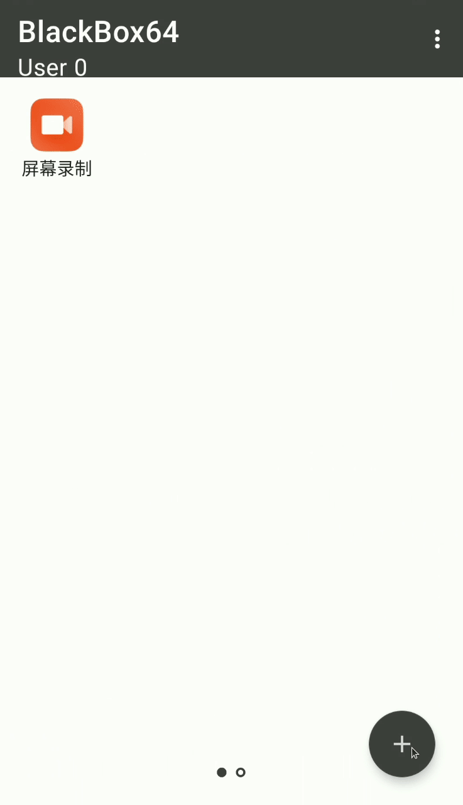

# CatEngine: Advanced Android Virtualization, Simulation & Prediction Engine

[](https://android.com)
[]()
[]()
[]()
[](LICENSE)

CatEngine is a high-performance Android virtualization platform and deterministic 2D game physics simulation and prediction system. Built on a modernized, user-space virtual process container (**BlackBox Core**), CatEngine enables in-process game introspection, low-latency OpenGL ES predictive trajectory rendering, and authorized test automation without requiring Android root privileges or external hardware.

<p align="center">
  
</p>

---

## Architecture & System Overview

CatEngine operates an in-process virtualization model where target applications are isolated within a sandbox process (`:p0`). The application interacts with system services via proxied Android IPC, while native engine hooks intercept graphics rendering and physics events for accurate trajectory forecasting.

```
┌────────────────────────────────────────────────────────────────────────┐
│                        CatEngine Host App (:app)                       │
│  - Jetpack Compose Material 3 UI                                       │
│  - BlackBox Virtualization Manager & Package Installer                 │
│  - Board Calibration & Trajectory Visual Customization Overlay         │
└───────────────────────────────────┬────────────────────────────────────┘
                                    │ Launches in Sandbox
                                    ▼
┌────────────────────────────────────────────────────────────────────────┐
│                   Virtual Sandbox Container (:p0)                      │
│                                                                        │
│   ┌────────────────────────────────────────────────────────────────┐   │
│   │                    Target App (Carrom Pool)                    │   │
│   │  - Cocos2d-x Engine / Dalvik-ART Runtime                       │   │
│   │  - libgame.so (AArch64 Native Game & Table Logic)              │   │
│   └───────────────────────────────┬────────────────────────────────┘   │
│                                   │ In-Process Shared Virtual Memory   │
│                                   ▼                                    │
│   ┌────────────────────────────────────────────────────────────────┐   │
│   │                   CatEngine Native (libengine.so)              │   │
│   │  - BlackBox Core (IO, Binder, System Call Redirection)         │   │
│   │  - Dobby Inline Hook & xDL Linker Symbol Resolution            │   │
│   │  - GLES eglSwapBuffers Interception & Trajectory Drawing       │   │
│   │  - PhysicsEngineV2: 1000 Hz Continuous Collision Detection     │   │
│   └────────────────────────────────────────────────────────────────┘   │
└────────────────────────────────────────────────────────────────────────┘
```

---

## Key Features

1. **Rootless Virtual Container**:
   Runs commercial Android applications in user-space sandbox processes without root permissions, kernel patches, or system modifications.
2. **Android 15 & 16KB Page-Size Compliant**:
   Native binaries (`libengine.so`) are linked with `-z,max-page-size=16384` (`0x4000` alignment), fully satisfying Android 15 compatibility requirements on modern ARM64 chips.
3. **Deterministic 2D Physics Simulator (`PhysicsEngineV2`)**:
   - Microsecond-accurate continuous collision detection (CCD) resolving disc-to-disc and disc-to-cushion rebounds.
   - Dynamic Coulomb friction model with authentic slip-to-roll transitions ($\mu \approx 0.160$ sliding, $\mu \approx 0.108$ rolling).
   - Gravitational funnel attraction modeling within corner pocket capture radii ($980.0\text{ cm/s}^2$).
4. **Unified Prediction Pipeline**:
   Trajectory visualizers and shot-selection solvers share the exact same physics engine, eliminating divergence between rendered lines and physical coin paths.
5. **Zero-Latency In-Game Overlay**:
   Intercepts OpenGL ES display frames (`eglSwapBuffers`) via Dobby, rendering laser trajectory paths synchronously before frame display.

---

## Repository Structure

```
-CatEngine/
├── app/                        # Android host application (Jetpack Compose UI)
├── Bcore/                      # Core Virtualization & Native Engine (libengine.so)
│   ├── src/main/aidl/          # Virtual system services IPC interfaces
│   ├── src/main/cpp/           # Native source: BoxCore, Dobby, xDL, CatEngine, Physics
│   │   ├── catEngine/          # GLES hooks, calibration, and PhysicsEngineV2
│   │   ├── Dobby/              # Prebuilt static hooking libraries (arm64-v8a, armeabi-v7a)
│   │   └── xdl/                # Dynamic symbol resolver
│   └── src/main/java/          # Virtual framework hooks (AMS, PMS, WMS, Window)
├── black-reflection/           # Compile-time reflection annotation library
├── compiler/                   # JavaPoet annotation processor for BlackReflection
├── docs/                       # Comprehensive Engineering & Research Documentation
│   ├── architecture/           # System architecture and memory contracts
│   ├── audit/                  # Repository audit and technical reports
│   ├── developer/              # Developer guide and coding conventions
│   ├── research/               # APK analysis, physics research, and CV designs
│   └── roadmap/                # Implementation roadmap and testing milestones
├── tools/                      # Tooling, maintenance scripts, and analysis harnesses
│   ├── analysis/               # Offline APK inspection and binary tooling
│   └── scripts/                # Repository maintenance and build automation
├── build.gradle                # Root Gradle configuration
├── settings.gradle             # Subproject inclusion & dependency resolution
└── PROJECT_PROGRESS.md         # Real-time task progress matrix
```

---

## Getting Started

### Prerequisites
- **Operating System**: Windows 11 / Linux / macOS
- **Android SDK**: Build-Tools `35.0.0`, Platform `android-35`
- **Android NDK**: Version `28.2.13676358`
- **JDK**: Java 17 (Azul Zulu or OpenJDK recommended)

### Building the Project
```powershell
# Clone the repository
git clone https://github.com/Ayub131132/-CatEngine.git
cd -CatEngine

# Switch to the implementation branch
git checkout feature/catengine-complete-implementation

# Assemble the complete debug APK
.\gradlew.bat :app:assembleDebug
```
The output APK will be generated at:
`app/build/outputs/apk/debug/CatEngine_1.0.0_debug.apk`

### Installing & Running via ADB
```powershell
# Verify connected testing device
adb devices -l

# Install the debug APK
adb install -r app/build/outputs/apk/debug/CatEngine_1.0.0_debug.apk

# Launch the CatEngine host UI
adb shell am start -n com.engine.cat/top.niunaijun.blackboxa.view.main.MainActivity
```

---

## Documentation Index

Detailed engineering reports are available in the [docs/](docs/) directory:

* **Architecture**: [CATENGINE_ARCHITECTURE.md](docs/architecture/CATENGINE_ARCHITECTURE.md)
* **Technical Audit**: [PROJECT_AUDIT.md](docs/audit/PROJECT_AUDIT.md)
* **Binary Reverse Engineering**: [APK_ANALYSIS.md](docs/research/APK_ANALYSIS.md)
* **Gameplay Dynamics**: [GAME_BEHAVIOUR_RESEARCH.md](docs/research/GAME_BEHAVIOUR_RESEARCH.md)
* **Physics Engine Design**: [PHYSICS_ENGINE_RESEARCH.md](docs/research/PHYSICS_ENGINE_RESEARCH.md)
* **Computer Vision Pipeline**: [COMPUTER_VISION_RESEARCH.md](docs/research/COMPUTER_VISION_RESEARCH.md)
* **Toolchain & Dependencies**: [DEPENDENCY_AND_TOOL_REVIEW.md](docs/research/DEPENDENCY_AND_TOOL_REVIEW.md)
* **Implementation Roadmap**: [IMPLEMENTATION_ROADMAP.md](docs/roadmap/IMPLEMENTATION_ROADMAP.md)
* **Developer Guide**: [DEVELOPER_GUIDE.md](docs/developer/DEVELOPER_GUIDE.md)

---

## Legal & Safety Notice

CatEngine is developed strictly for **educational research, interoperability analysis, and authorized test automation in owned environments**. CatEngine does not circumvent DRM, crack game protections, manipulate third-party online matches, or provide unfair competitive advantages. Automated tests must only be run on owned devices or private testing matches.

---

## License

Copyright (c) 2026 CatEngine Contributors.  
Licensed under the [Apache License, Version 2.0](LICENSE).
